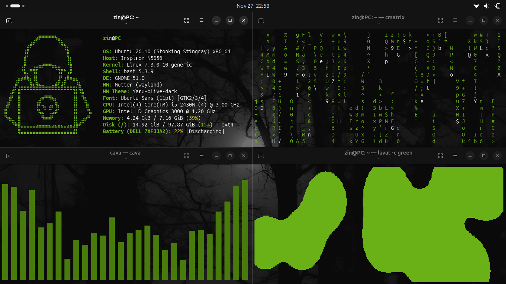
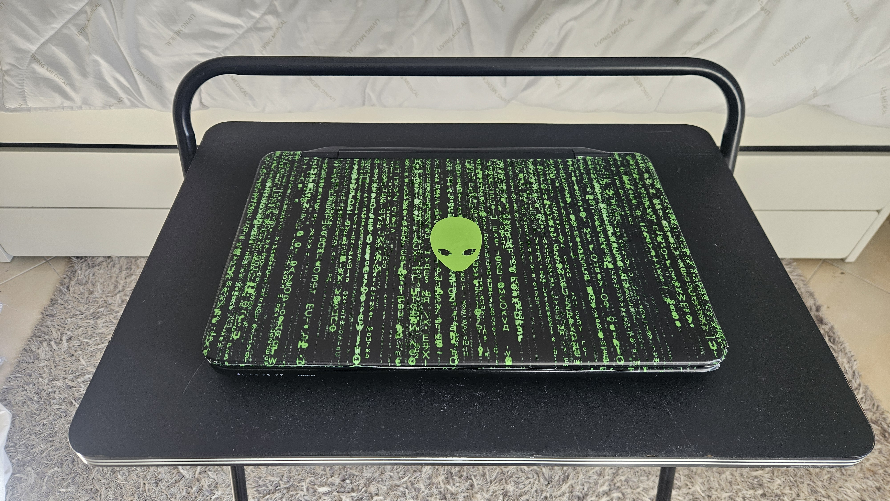
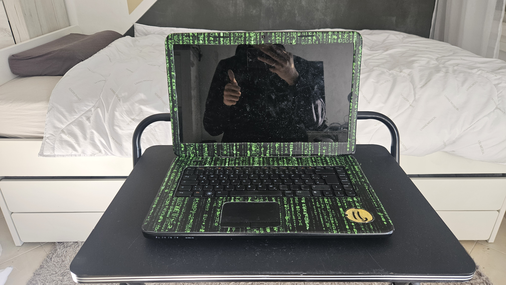

# Miski54's Linux hacker rice
This repository has my Linux rice from my old laptop which is wrapped in a hacker cmatrix vinyl.\
\

  
  

## Details
| Component | Name |
| :--- | :--- |
| **OS** | Ubuntu |
| **Desktop Environment** | GNOME |
| **Terminal** | Ptyxis |
| **Terminal Palette** | Elementary |
| **Terminal Opacity** | 60% transparent |
| **Font** | Monospace 10 |
| **System Info** | [fastfetch](https://github.com/fastfetch-cli/fastfetch) |
| **Audio Visualizer** | [cava](https://github.com/karlstav/cava) |
| **Terminal Toys** | [cmatrix](https://github.com/abishekvashok/cmatrix), [lavat](https://github.com/AngelJumbo/lavat) |
| **GTK / Icon Theme** | Yaru-olive-dark |
| **Wallpaper** | [wallpaper.png](wallpaper.png) |

## Wallpaper — the easiest part
To get my wallpaper, simply just download it [here](wallpaper.png).

## Terminal theme
I use the Elementary color palette for the Ptyxis terminal. "To make the terminal's background transparent, open your Ptyxis terminal menu (hamburger icon), go to **Preferences** > **Appearance**, scroll down to **Transparency**, and set it to 60% or type this command in your terminal:\
`gsettings set org.gnome.Ptyxis.Profile:/org/gnome/Ptyxis/Profiles/$(gsettings get org.gnome.Ptyxis default-profile-uuid | tr -d "'")/ opacity 0.60`
> If you want to change the opacity to another value, replace 0.60 at the end of the command with any decimal between 0 (transparent) and 1 (opaque).

## <a name="apps">Apps</a>
My rice consists of:
- [fastfetch](https://github.com/fastfetch-cli/fastfetch)
- [cmatrix](https://github.com/abishekvashok/cmatrix)
- [lavat](https://github.com/AngelJumbo/lavat)
- [cava](https://github.com/karlstav/cava)

## Setup
For setting up the whole rice, follow these steps:
1. Download the apps listed in the [Apps](#apps) section above.
2. Download the [`fastfetch`](.config/fastfetch) and [`cava`](.config/cava) folders which are located in the [`.config`](Miski54s-Linux-Rice/.config/fastfetch) folder.
3. Navigate to `~/.config` on your device (If you don't see it immediately, it's probably hidden. Use <kbd>Ctrl</kbd> + <kbd>H</kbd> in your file manager or `ls -a` in your terminal).
4. Move the [`fastfetch`](.config/fastfetch) and [`cava`](.config/cava) folders to the `.config` folder.
5. For running [cmatrix](https://github.com/abishekvashok/cmatrix), type `cmatrix` and write `-C green` if your cmatrix displays a different color than green.
6. For running [lavat](https://github.com/AngelJumbo/lavat), type `lavat -c green`.

## Contributing
This repository is only for others to see my personal rice. I'm not accepting pull requests at this time.

## Liked this rice?
Don't be afraid to star this repo — I won't complain :)
